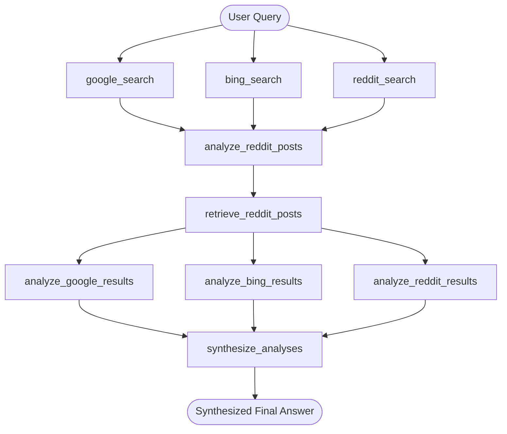

<div align="center">

# 🌐 Bayan Multi-Search AI (منظومة بيان الذكية)

**Multi-Source Retrieval, Cross-Verification & Knowledge Synthesis Engine**

[](https://github.com/Mo-Alwosabi/Bayan-Multi-Search-AI)
[](https://github.com/Mo-Alwosabi/Bayan-Multi-Search-AI)
[](https://github.com/Mo-Alwosabi/Bayan-Multi-Search-AI)
[](https://github.com/Mo-Alwosabi/Bayan-Multi-Search-AI)
[](LICENSE)

*Engineered by **[Mohammed Alwosabi](https://github.com/Mo-Alwosabi)** — AI & Machine Learning Systems Engineer*

</div>

---

## 🎯 Overview

**Bayan Multi-Search AI (بيان AI)** is an autonomous multi-source intelligence and synthesis pipeline built on **LangGraph** and **LangChain**. Instead of relying on a single search engine or unverified LLM memory, Bayan dispatches **parallel retrieval agents** across **Google SERP**, **Bing SERP**, and **Reddit Communities**, extracts deep community discussions, scores and analyzes each source independently, and fuses all verified findings into one structured, high-signal answer.

### ✨ Key Engineering Highlights
- **Parallel Multi-Source Fan-Out:** Executes Google, Bing, and Reddit retrieval concurrently inside a deterministic 9-node `StateGraph`.
- **Deep Community Thread Mining:** Automatically selects high-relevance Reddit threads (`analyze_reddit_posts`) and retrieves full comment trees (`retrieve_reddit_posts`) via async snapshot polling.
- **Independent Source Analysts:** Dedicated LLM evaluation nodes (`analyze_google_results`, `analyze_bing_results`, `analyze_reddit_results`) prevent cross-source contamination before synthesis.
- **Cyber-Cyan & Deep Indigo RTL Dashboard:** Custom Streamlit interface featuring Arabic RTL layout, per-source priority scoring, quick insights, and one-click `.txt` report export.

---

## 🏗️ 9-Node LangGraph Architecture (`main.py`)



---

## 🛠️ Project Structure

```text
Bayan-Multi-Search-AI/
├── .streamlit/
│   └── config.toml            # Cyber-Cyan & Deep Indigo dark UI theme
├── main.py                    # 9-node LangGraph orchestration & CLI runner
├── streamlit.py               # Interactive RTL Streamlit intelligence dashboard
├── web_operations.py          # Google, Bing, and Reddit search API connectors
├── snapshot_operations.py     # Async dataset snapshot polling & downloader
├── prompts.py                 # Source-specific analysis & synthesis prompt templates
├── pyproject.toml             # Project metadata & dependencies
├── requirements.txt           # Production dependencies
├── .env.example               # Environment variables template
└── README.md                  # Documentation
```

---

## 🚀 Quick Start

### 1. Clone the Repository
```bash
git clone https://github.com/Mo-Alwosabi/Bayan-Multi-Search-AI.git
cd Bayan-Multi-Search-AI
```

### 2. Setup Environment & Dependencies
```bash
python -m venv .venv
.venv\Scripts\activate
pip install -r requirements.txt
```

### 3. Configure API Keys
Copy `.env.example` to `.env` and add your keys:
```ini
OPENAI_API_KEY=your_openai_api_key_here
BRIGHTDATA_API_KEY=your_brightdata_api_key_here
```

### 4. Run the Application

#### Interactive Streamlit Dashboard:
```bash
streamlit run streamlit.py
```

#### CLI Mode:
```bash
python main.py
```

---

## 👨‍💻 Author & Contact

**Mohammed Alwosabi** — *AI & Machine Learning Systems Engineer*  
Specializing in Multi-Agent Systems, Advanced RAG, and Sovereign Local AI Inference.

- 🐙 **GitHub:** [@Mo-Alwosabi](https://github.com/Mo-Alwosabi)
- 💼 **LinkedIn:** [Mohammed Alwosabi](https://www.linkedin.com/in/mohammed-al-wosabi-609a693a1)
- 📧 **Email:** `ai.mohammed.alwosabi@gmail.com`
- 📍 **Location:** Sana'a, Yemen
